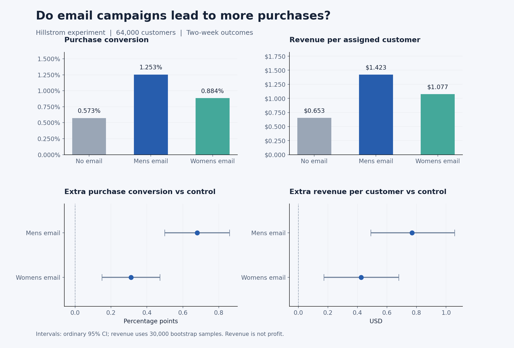
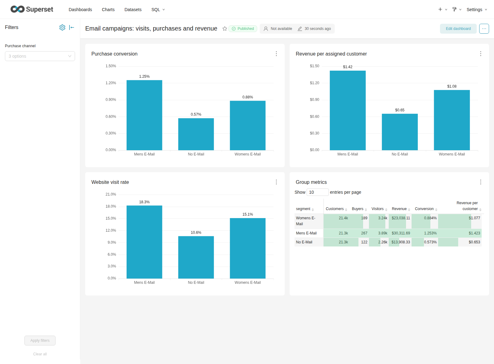

# Email Campaign A/B Analysis

Учебный проект по анализу email-рассылок. Я взял открытые данные эксперимента Hillstrom и проверил, приводят ли письма к дополнительным покупкам, а не только к посещениям сайта.

В данных 64 000 клиентов и три группы: Mens E-Mail, Womens E-Mail и контроль без рассылки. Названия писем относятся к товарам в рассылке, а не к полу клиентов. Результаты собирали две недели после отправки.

## Что получилось

| Метрика | Без письма | Mens | Womens |
|---|---:|---:|---:|
| Клиентов | 21 306 | 21 307 | 21 387 |
| Покупателей | 122 | 267 | 189 |
| Конверсия | 0,573% | 1,253% | 0,884% |
| Выручка на клиента | $0,653 | $1,423 | $1,077 |

Обе рассылки показали положительный эффект относительно контроля. У Mens прирост конверсии составил **0,681 процентного пункта**, у Womens — **0,311 п. п.** После поправки Holm оба результата статистически значимы на уровне 5%.

У Mens дополнительная выручка на клиента составила **$0,770**, bootstrap 95% интервал — **[$0,491; $1,059]**. У Womens — **$0,424**, интервал **[$0,173; $0,681]**.



## Что я сделал

- Проверил пропуски, значения признаков и размеры групп в pandas.
- Посчитал посещения, конверсию и выручку на клиента.
- Повторил основные расчёты в SQL и сверил их с Python.
- Сравнил рассылки с контролем, рассчитал доверительные интервалы и поправку Holm.
- Сделал Excel-файл с формулами и дашборд в Apache Superset.

В исходных данных 6 562 полностью совпадающие строки. Я не удалял их: ID клиента нет, поэтому одинаковые признаки ещё не означают, что это один и тот же человек.

## Как запустить

Нужен Python 3.12. Исходный CSV уже лежит в репозитории, скачивать его повторно не нужно.

```bash
python3 -m venv .venv
source .venv/bin/activate
pip install -r requirements.txt
python run_analysis.py
python -m unittest discover -s tests -v
```

В Windows среда активируется командой `.venv\Scripts\activate`.

Скрипт сохранит таблицы в `results/`, график в `reports/figures/` и локальную SQLite-базу для SQL и Superset. Ноутбук можно открыть в VS Code или Jupyter, выбрав ту же среду Python.

## Где смотреть

- [Ноутбук с ходом анализа](notebooks/email_experiment.ipynb)
- [Excel с формулами](excel/email_campaign_analysis.xlsx)
- [Инструкция и скриншот Superset](bi/README.md)
- [Подробный отчёт и методы](reports/analysis.md)
- [Описание полей и источник](data/README.md)
- [SQL-запросы](sql/)

В Excel на листе `Campaign analysis` можно менять размер аудитории и смотреть пересчёт ожидаемого эффекта. На листе `Data` сохранены четыре исходных поля по всем клиентам. Статистические интервалы импортированы из Python, а основные метрики рассчитываются формулами Excel.

Superset запускается локально через Docker. Так выглядит готовый дашборд:



В [GitHub Actions](https://github.com/qeepsileee/email-campaign-ab-analysis/actions) проверяются шесть тестов, выполнение ноутбука и загрузка графиков Superset в браузере.

## Как я проверял гипотезы

Основная метрика — конверсия в покупку. Для неё использовал двусторонний z-тест и поправку Holm на два сравнения с контролем. Доверительные интервалы обычные 95%, без поправки на множественность.

Выручку считал на всех клиентов группы, включая тех, кто ничего не купил. Для её интервалов использовал 30 000 bootstrap-выборок, seed `20261111`. Посещения и выручка — дополнительные метрики. Анализ сегментов оставил исследовательским.

## Мой вывод

По этому эксперименту Mens — более перспективный общий вариант рассылки. Но я не могу сделать вывод о прибыли: в данных нет стоимости кампании и маржи. Также это старый эксперимент, и для новой аудитории я бы предложил повторную проверку.

При пересчёте оценки на 10 000 похожих клиентов Mens даёт примерно 68 дополнительных покупателей и $7 698 выручки за две недели. Это оценка по эксперименту, а не фактически проведённая мной кампания.

## Данные

Источник — [Kevin Hillstrom / MineThatData](https://blog.minethatdata.com/2008/03/minethatdata-e-mail-analytics-and-data.html). Я анализировал опубликованный эксперимент, а не организовывал его. Вопросы о правах на исходные данные относятся к их автору; лицензия на код не распространяется на CSV.

Автор проекта: [Zamanbek Baktzhan](https://github.com/qeepsileee).
